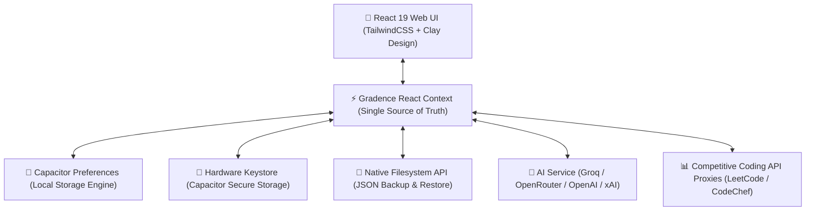

# ⚜️ ASCENDANT — The Academic Operating Companion

<div align="center">


**An offline-first, private academic workspace engineered for structured student growth, grade tracking, predictive attendance forecasting, competitive programming analytics, and intelligent career preparation.**

[Overview](#-overview) • [Key Features](#-key-features) • [Architecture](#-architecture) • [Design System](#-design-system) • [Installation](#-installation--setup) • [Deployment](#-deployment) • [Contributing](#-contributing)

</div>

---

## 🏛️ Overview

**ASCENDANT** is an integrated academic companion designed to eliminate the friction of fragmented student tools. Rather than managing GPAs in browser calculators, class attendance on basic checklists, timetable spreadsheets, and competitive coding profiles across half a dozen tabs, ASCENDANT unifies everything into a single, cohesive, local-first workspace.

Built with an elegant **Cosmic Latte & Deep Burgundy** aesthetic inspired by classical academia and modern tactile neumorphism ("Claymorphism"), ASCENDANT prioritizes focus, clarity, and complete student privacy.

---

## ✨ Key Features

### 🎓 1. CGPA & Academic Standing Engine
* **Universal Scale Support:** Seamlessly switch between **10.0 Scale** (O, A+, A, B+, B, C, D) and **4.0 Scale** (A, A-, B+, B, etc.).
* **Course Credit Weighting:** Accurate credit distribution and semester-by-semester SGPA & CGPA tracking.
* **Target GPA Predictor:** Simulates the exact minimum SGPA required in remaining semesters to achieve your target graduation CGPA.
* **Academic Converters:** Instantly convert CGPA to percentage, simulate new course weight impacts, and project graduation honors.

### 🛡️ 2. Predictive Attendance Management
* **Real-Time Safety Margins:** Calculates exactly how many lectures you can safely skip (or must attend) to stay above institutional cutoffs (e.g., 75% or 80%).
* **Visual Health Indicators:** Color-coded status alerts warn you before attendance drops into the penalty zone.
* **Timetable Integration:** Syncs scheduled subjects with your daily lecture schedule.

### 🎠 3. Cinematic 3D Curved Ribbon Showcase & Split Hero
* **3D Curved Perspective Carousel:** An interactive, curved horizontal gallery showcasing all academic utilities with depth-scaled perspective, natural lighting, and smooth fluid animation.
* **Split-Hero Companion:** A balanced 50/50 dashboard hero featuring the Student Operating Companion metrics on the left and a dedicated Daily Motivation & Quote card on the right, complete with interactive quote cycling and CGPA medallion.

### 🤖 4. AI Study Companion & Placement OS
* **Lightning-Fast Inference:** Powered by Groq Cloud (Llama 3.3 70B, Llama 3.1 8B, OpenAI GPT-OSS, Qwen 2.5), with multi-provider fallback routing to OpenRouter, OpenAI, and xAI Grok.
* **Dynamic Model Auto-Discovery:** Automatically queries authorized models for your API key and provides a real-time **Test Key** diagnostic tool in Settings.
* **High-Contrast Readability:** Specially tuned warm ivory text on burgundy chat bubbles for comfortable, strain-free reading.
* **ATS Resume Scorer:** Evaluates resume text against job descriptions, identifies missing keywords, and calculates match compatibility.
* **Skills Alignment & Roadmaps:** Generates semester-by-semester learning roadmaps for SWE, Cloud Architecture, AI/ML, and Higher Studies.

### 💻 5. Competitive Coding Aggregator
* **Multi-Platform Analytics:** Consolidates live problem-solving counts, contest ratings, and global ranks across **LeetCode**, **Codeforces**, **GitHub**, and **CodeChef**.
* **Zero CORS Stalls:** Includes built-in API proxy rewrites for fast, reliable data retrieval on both web and mobile runtimes.

### 📅 6. Smart Calendar & Campus Opportunities
* **AI Academic Calendar Parser:** Upload institutional PDF schedules to automatically extract, structure, and categorize academic deadlines, exam periods, and holidays using PDF.js and LLM parsing.
* **Campus & Global Hackathons:** Aggregates college campus events alongside national competitions and hackathons pulled directly from Unstop.

### 📄 7. SECE-Aligned Resume Builder
* **Engineering Standards:** Generates print-ready engineering resumes adhering strictly to SECE placement guidelines.
* **Live Interactive Preview:** Real-time form editing with instant PDF generation and download via `jsPDF`.

### 🔒 8. Local-First Privacy & Hardware Keystore
* **No Cloud Lock-In:** All grades, attendance logs, and student details are stored directly on your device storage via Capacitor Preferences.
* **Hardware Keystore:** API credentials are encrypted inside native hardware containers (Android Keystore / iOS Keychain).
* **Complete Data Portability:** Export and import your entire database at any time using standard JSON backup files.

---

## 🏗️ Architecture



---

## 🎨 Design System

ASCENDANT uses a bespoke classical-academic design system crafted with tactile claymorphism:

| Element | Color Code | Role |
| :--- | :--- | :--- |
| **Burgundy** | `#722f37` / `#5A232A` | Primary brand accent, headings, active buttons, medals |
| **Cosmic Latte** | `#FAF6EE` | Background canvas, card surface base, ivory text |
| **Warm Sand** | `#F3EDE2` | Secondary containers, inset inputs, subtle dividers |
| **Muted Taupe** | `#B7A89A` | Subtle borders, muted captions, secondary metadata |
| **Emerald Accent** | `#059669` | High attendance safety marks, verified statuses |

---

## 🚀 Installation & Setup

### Prerequisites
* **Node.js**: v18.0.0 or higher
* **npm**: v9.0.0 or higher
* *(Optional for Android)*: Android Studio with Android SDK 34+

### 1. Clone the Repository
```bash
git clone https://github.com/tharikashri-19/ASCENDANT.git
cd ASCENDANT
```

### 2. Install Dependencies
```bash
npm install
```

### 3. Run Development Server
```bash
npm run dev
```
Open [http://localhost:3000](http://localhost:3000) in your browser.

### 4. Build for Production
```bash
npm run build
```

---

## 📱 Android Build (Capacitor)

To compile and sideload the native Android APK:

```bash
# Build web assets
npm run build

# Sync assets with native Android project
npx cap sync android

# Open Android project in Android Studio
npx cap open android
```

From Android Studio, click **Build > Build Bundle(s) / APK(s) > Build APK(s)** to generate the distributable `.apk` package.

---

## ☁️ Deployment

### Deploy to Vercel
ASCENDANT is fully configured for Vercel deployment with client-side SPA routing and API proxy rewrites included in [`vercel.json`](vercel.json):

1. Push your code to your GitHub repository:
   ```bash
   git push -u origin main
   ```
2. Import the repository into your [Vercel Dashboard](https://vercel.com).
3. The build command (`npm run build`) and output directory (`dist`) are automatically recognized.
4. Click **Deploy**!

---

## 🛠️ Tech Stack

* **Frontend:** React 19, TypeScript, Vite 6, Tailwind CSS
* **Animations & Icons:** Framer Motion, Lucide React
* **Document Processing:** PDF.js (`pdfjs-dist`), jsPDF
* **Native Runtime:** Capacitor 7 (`@capacitor/core`, `@capacitor/preferences`, `@capacitor/filesystem`)
* **AI Intelligence:** Groq Cloud SDK (Llama 3.3, GPT-OSS, Qwen 2.5), OpenRouter, OpenAI API
* **Deployment:** Vercel / Capacitor Android APK

---

## 🤝 Contributing

Contributions, feedback, and feature requests are welcome!

1. Fork the Project.
2. Create your Feature Branch (`git checkout -b feature/AmazingFeature`).
3. Commit your Changes (`git commit -m 'feat: Add AmazingFeature'`).
4. Push to the Branch (`git push origin feature/AmazingFeature`).
5. Open a Pull Request.

---

## 📄 License

Distributed under the **MIT License**. See `LICENSE` for more information.

<div align="center">

Built with precision for students by [tharikashri-19](https://github.com/tharikashri-19)

**A S C E N D A N T**

</div>